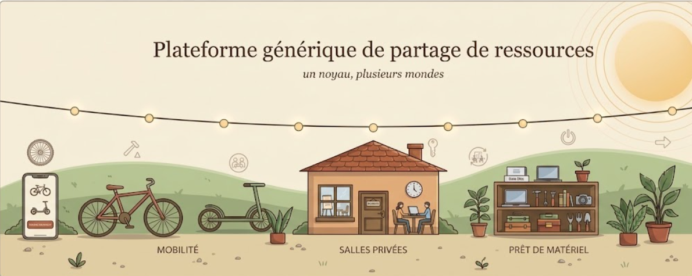

# Plateforme générique de partage de ressources

## Présentation

Ce projet consiste à concevoir une plateforme générique permettant de réserver et de louer différents types de ressources à partir d'une seule application.

## Domaines d'application

- **Mobilité urbaine :** location de vélos.
- **Réservation de salles :** réservation de salles privées pour réaliser des entretiens dans un environnement calme.
- **Évolutions futures :** prêt de matériel, comme des ordinateurs portables et des vidéoprojecteurs.

## Objectif

Concevoir une architecture logicielle générique, configurable et extensible, permettant d'ajouter de nouveaux types de ressources sans modifier systématiquement le noyau principal.

## Organisation du projet

- `docs/` : documentation et étude des besoins.
- `diagrams/` : diagrammes UML du projet.

## Équipe

Projet réalisé dans le cadre de la formation en Génie Logiciel (GL3).
